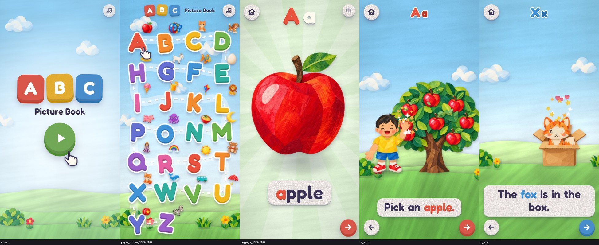
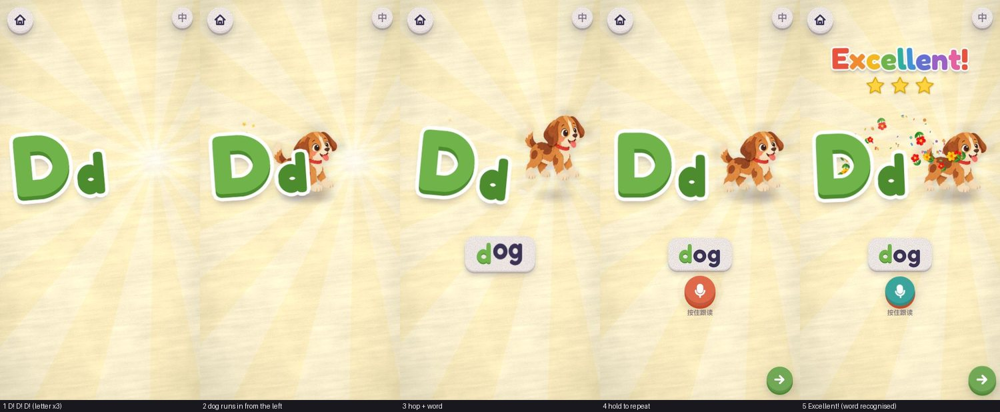
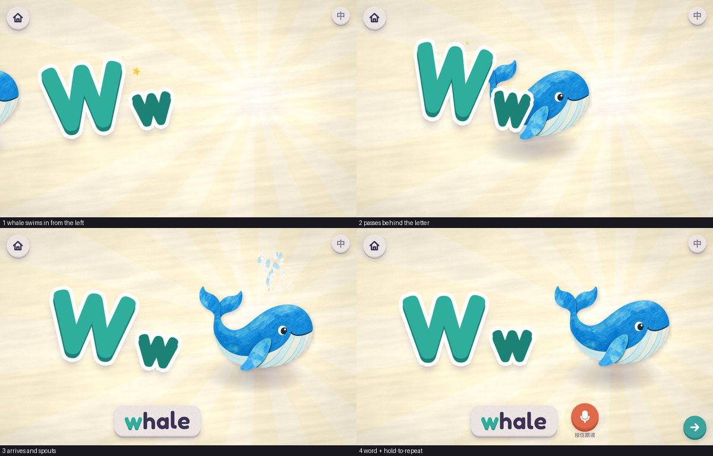

# ABC Picture Book · 会动的字母绘本

给 4 岁以下孩子的英语启蒙小网站：26 个字母，每个字母一个单词、一句话、一幕会动的剪纸小剧场。
纯静态站点，已部署在 GitHub Pages：**<https://baroncyrus.github.io/abc-picture-book/>**



```
封面（点一下开始，解锁声音）
  └─ 首页：26 个大写字母沿缝线小路排开，蝴蝶从 A 飞到 Z
       └─ 单词页：左边大字母，右边实物
            · 进页先欢快地读三遍字母（A! A! A!），实物再从屏幕左边"按自己的方式"出场
            · 点字母：字母跳一下并读出来；点实物或单词：实物做招牌动作并读单词（动物还会叫）
            · 按住麦克风跟读，松手后给 Excellent / Great / Good + 星星、撒花，再播放孩子自己的声音
            └─ 故事页：一句话的小动画，播完定格成绘本；点画面重播
                 └─ 下一个字母 …
```





## 运行

```bash
npm install
```

```bash
npm run dev
```

```bash
npm run build
```

`npm run build` 的产物在 `dist/`，使用相对路径，放在任何子目录下都能跑。
推送到 `main` 分支后，`.github/workflows/pages.yml` 会自动构建并发布到 GitHub Pages。

插画原图（`art/raw/`、`art/parts/` 下的 PNG）用 Git LFS 存放；只想跑网站不需要它们
（`GIT_LFS_SKIP_SMUDGE=1 git clone …` 可跳过下载），要重新导出精灵图时再 `git lfs pull`。

## 目录

| 路径 | 内容 |
| --- | --- |
| `src/data/letters.json` | **内容表**：每个字母的单词、句子、中文提示、颜色 |
| `src/pages/` | 三个页面：`home.js` 首页、`word.js` 单词页、`story.js` 故事页；`motions.js` 是单词页 26 个实物的出场 / 待机 / 点击动作表 |
| `src/scenes/` | 26 个故事场景（`a.js` … `z.js`）和通用动作库 `kit.js` |
| `src/gl/` | 渲染引擎：纸片精灵 + 柔影（`sprite.js`）、程序化剪纸背景（`backdrop.js`）、纸偶骨骼（`kid.js`）、粒子（`fx.js`）、手绘小图形（`shapes.js`） |
| `src/core/` | 路由与封面（`router.js`）、转场（`wipe.js`）、朗读与音效（`audio.js`）、背景音乐（`music.js`）、跟读录音（`mic.js`）与评分（`speech.js`）、存档（`store.js`） |
| `public/art/` | 处理好的 WebP 精灵图（由 `tools/art.py` 生成，不要手改） |
| `public/audio/` | 朗读音频（由 `tools/tts.py` 生成） |
| `art/raw/`、`art/parts/` | 插画原图与切好的零件；`art/manifest.json` 是原图 → 精灵图的清单 |
| `art/PROMPTS.md` | 生成插画用的提示词与风格手册 |
| `tools/` | 素材、语音、测试脚本 |

## 改内容

### 换一个单词或句子

1. 改 `src/data/letters.json` 里对应字母的 `word` / `sentence` / `zh` / `sentenceZh`。
   句子里的目标单词会自动高亮；想高亮单词里的非首字母（如 fo**x**）用 `"hl": [2]`。
2. 重新生成这个字母的语音（会同时更新逐词高亮的时间轴）：

   ```bash
   uv run --with edge-tts --with numpy python tools/tts.py --only a --force
   ```

3. 用语音识别核对读音有没有读错（可选）：

   ```bash
   uv run --with faster-whisper python tools/verify_audio.py
   ```

### 换一张图

1. 按 `art/PROMPTS.md` 的模板出图，透明底 PNG 放进 `art/raw/`。
2. 在 `art/manifest.json` 里登记（单词主图的名字 = 单词去掉空格和连字符，如 `icecream`、`yoyo`）。
3. 重新生成精灵图：

   ```bash
   uv run --with scipy --with numpy --with pillow python tools/art.py build
   ```

多个零件画在一张图上时，先 `python tools/art.py slice <文件名>` 切开，再在清单里引用 `parts/<文件名>/<序号>.png`。

### 写 / 改一个故事场景

每个场景是一个小模块（见 `src/scenes/a.js`，约 60 行）：

```js
export default {
  art: ['tree', 'cloud1'],      // 除单词主图外还要用到的精灵图
  kid: true,                    // 是否需要小朋友纸偶
  backdrop: 'meadow',           // 背景预设，见 src/gl/backdrop.js 的 SCENES
  build(S) {
    const { tl, fx, sfx, ground } = S;        // tl = GSAP 时间轴，ground = 地面 y 坐标 (-300)
    const kid = S.kid({ height: 430 }).at(-240, ground);
    const apple = S.sprite('apple', { w: 104 }).at(-112, 112);
    kid.walk(tl, 0.1, -150, 1.2);             // 走过去
    S.say(2.0);                               // 在第 2 秒开始朗读句子（自动逐词高亮）
    kid.pose(tl, { armR: 168, foreR: 6 }, 0.3, 2.1);   // 举起右手
    tl.call(() => fx.sparkle(0, 100), null, 2.4);      // 撒星星
  },
};
```

- 舞台是 1000×1000 的设计坐标，原点在中心、y 向上；地面线在 `y = -300`。
  主要动作请放在 `x ∈ [-420, 420]` 内（窄屏手机两侧各会裁掉约 6%）；`y < -330` 的区域会被台词卡片盖住。
- 纸偶关节角度：`armL / armR`（0 垂下、90 平举、180 举高，负值向身体内侧）、`foreL / foreR`（肘）、`legL / legR`、`head`、`lean`；表情 `kid.face = 'a' | 'b' | 'c'`（微笑 / 闭眼 / 大笑）。
  手里拿东西用 `kid.give('R', sprite)`，移动时用 `kid.carry(...)` 保持物品直立。
- 时间轴播完后页面自动定格、停止渲染（省电），点画面会重建场景再播一遍。

### 首页字母的排列

`src/pages/home.js` 顶部的 `SERPENTINE`：`true` 为蛇形小路（偶数行从右往左），`false` 为每行都从左往右。

### 单词页的动作

`src/pages/motions.js` 顶部的 `MOTIONS` 表为每个字母定义：

- `enter`：出场方式。统一从屏幕左边进来，有跑、小跑、跳、滚、弹、游、飞、滑、开车、从左往右画出（彩虹）等。
- `idle`：待机时的小动作，比如摇摆、上下浮动、游动、冒热气。
- `act`：点击时的招牌动作，比如狗跳起来摇尾巴、狮子吼叫、雨伞撑开、鲸鱼喷水。
- `tail`：动物尾巴所在的图片区域，用着色器让这块单独摆动，不需要拆图。

动物叫声写在 `letters.json` 的 `sound` 字段里（如 `"Woof! Woof!"`），由童声读出。

### 跟读评分

跟读在本机完成，**录音不会上传或保存**：松手后立刻分析，播放给孩子听一遍后即丢弃。

评分先判断"说的是不是这个词"：

- 把孩子的发音转成声学指纹（MFCC）；
- 用动态时间规整（DTW）和 26 个词、每个词 10 种嗓音的范读模板逐一比对。模板涵盖成人女声、男声、童声，以及美式和英式口音，存在 `src/data/templates.json`，第一次按跟读时才下载，约 94KB。

| 情况 | 档位 |
| --- | --- |
| 目标词排第一 | Excellent |
| 大致像 | Great |
| 明显是另一个词 | Good（仍然鼓励） |
| 静音或太短 | Try again |

用"留出一种嗓音测试"的方式评估：

- 正确的词进前 3 名的比例是 97%；
- 说错的词被误判为对的比例是 4%。

需要说明的局限：

- 这些都是合成嗓音，**还没有用真实孩子的声音测过**；
- 它不是发音打分，分辨不了 "cat" 读成 "cut" 这类细节。

想要真正的发音测评，可以接入在线服务（如 Azure 发音测评、讯飞），替换 `src/core/speech.js` 里的 `grade()`。

改了单词或范读语音后，重建模板：

```bash
uv run --with edge-tts --with numpy python tools/tts.py --template-voices
```

```bash
node tools/templates.mjs
```

## 测试

开发服务器跑在 5183 端口时（`npm run dev -- --port 5183`）：

```bash
node tools/smoke.mjs
```

用本机 Chrome 无头模式以手机触屏尺寸走完整流程：封面解锁声音 → 首页音乐 / 提示 / 摇摆 → 单词页朗读 → 故事播放与定格 → 26 个字母全部播完，任何报错或 404 都会失败。

```bash
node tools/shots.mjs /tmp/shots --size 390x780 "story:a@1.0,2.4,end" "page:#/m@4"
```

批量截图：`story:<字母>@<时间点…>` 把场景冻结在指定秒数，`play:<字母>@0.3x16` 实时回放抽帧，`seq:<路由>@0.5x10` 从头打开任意页面连续抽帧，`page:<路由>@<等待秒>` 截任意页面。

```bash
node tools/mictest.mjs a /path/to/apple.wav
```

把一段 WAV 当作麦克风输入，按住跟读按钮，输出评分档位（用来检查跟读整条链路）。加 `SHOT=cheer.jpg SHOT_AT=1100` 可在松手 1.1 秒后截下夸奖画面。

```bash
node tools/livecheck.mjs https://baroncyrus.github.io/abc-picture-book/
```

发布后检查线上版本：从封面一路走到故事页，任何报错或请求失败都会列出来。

## 设计上的几个决定

- **封面**：手机浏览器在用户第一次触摸前不允许出声，所以用一个"点一下开始"的封面来解锁声音，之后朗读和音乐都能自动播放。
- **单页应用**：页面切换不刷新，声音权限得以保持；转场用卡通式的圆形擦除。
- **字体**：Fredoka（自托管，不依赖 Google Fonts）。它的 a、g 是单层写法，和孩子将来手写的字形一致。
- **朗读**：单词页由音高起伏更大、听感更欢快的 Emma 先读三遍字母再读单词，点击重读时与另一个成人女声 Ava 交替（多说话人有助于幼儿泛化语音）；故事页由语气平稳的 Ava 讲。所有语音都用语音识别逐条核对过。句子朗读时逐词高亮，帮助建立"声音—文字"的对应。
- **不出现中文**：孩子看到的只有英文和图；右上角的「中」按钮是给家长的中文提示，默认关闭。
- **X 用 fox**：字母 X 的常见发音 /ks/ 只出现在词尾，所以选了 fox 并高亮末尾的 x，句子 "The fox is in the box." 里出现两次。
- **背景音乐**：首页的音乐是代码实时合成的原创小曲（`src/core/music.js`），不占体积、没有版权问题；右上角可以关。

## 使用须知

- **朗读音频**由微软 Edge 的在线朗读服务（`edge-tts`）生成，适合做 Demo 验证。正式对外发布或商用前，建议换成有明确授权的语音（Azure TTS 官方接口有同款声音），或请真人录音后覆盖 `public/audio/` 下的同名文件。
- **插画**由 ChatGPT 图像生成制作，原图在 `art/raw/`。
- iOS 16 及更早版本在手机静音键打开时，网页音频会被系统静音（iOS 17+ 已处理）。
- 需要支持 WebGL2 的浏览器（近几年的 Chrome / Safari / Edge / 微信内置浏览器均可）；不支持时会显示提示。
